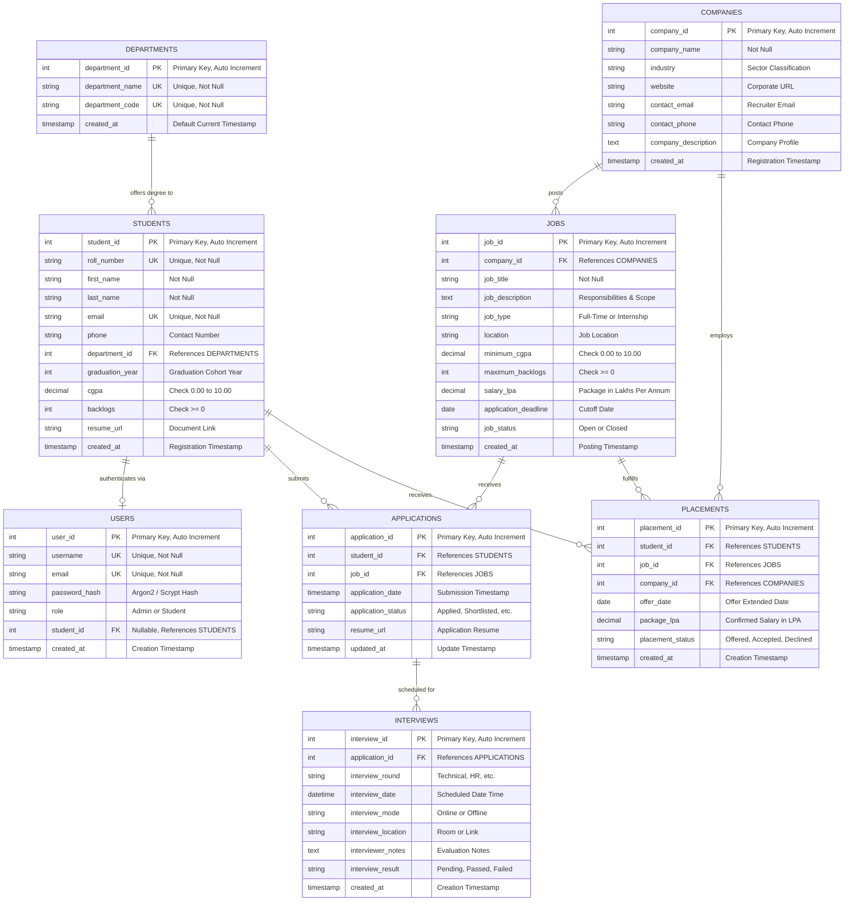

# Entity-Relationship (ER) Diagram & Data Model
## Student Placement Management System (SPMS)

### 1. Conceptual ER Modeling Overview
The Student Placement Management System (SPMS) models the core entities and operational relationships of a higher education placement and recruitment cell. The architecture resolves many-to-many relationships between Students and Job Postings through the associative entity **Applications**, and models confirmed career selections through **Placements**.

---

### 2. Mermaid Entity-Relationship Diagram

---

### 3. Entity Relationships & Cardinalities

1. **Departments to Students (1 : M)**
   - One Department can enroll many Students.
   - Each Student must belong to exactly one Department (`ON DELETE RESTRICT`).

2. **Students to Users (1 : 1 / 1 : 0..1)**
   - A registered student may have one User authentication record.
   - An administrator user does not link to any student (`student_id IS NULL`).

3. **Companies to Jobs (1 : M)**
   - A Company can publish multiple recruitment openings over time.
   - Each Job belongs to exactly one hiring Company (`ON DELETE RESTRICT`).

4. **Students to Jobs (M : N via Applications)**
   - A Student may submit applications to multiple Job openings.
   - A Job receives applications from multiple eligible candidates.
   - **Associative Entity**: `applications` resolves this M:N relationship, with a composite unique constraint `UNIQUE(student_id, job_id)`.

5. **Applications to Interviews (1 : M)**
   - An Application can progress through multiple sequential evaluation rounds (Assessment, Technical Round 1, Director Interview, HR Round).
   - Each Interview is tied to exactly one Application (`ON DELETE CASCADE`).

6. **Placements (Ternary Relationship between Student, Job, and Company)**
   - Each final offer links the placed Student, the Job role, and the recruiting Company.
   - `ON DELETE RESTRICT` guarantees that historical placement records cannot be accidentally deleted by cascading student or company removals.
